# Blood donation and management system

UE23CS352B, Object Oriented Analysis & Design. Healthcare mini project, Java web application.

Original team: Satwik R Bankapur (PES2UG23CS539), Sathwik HS (PES2UG23CS536), Prajwal K (PES234UG23CS818), Sudarshan JN (PES234UG23CS825).

Repository: https://github.com/hs-sathwikhs/Blood_Donation_System

## Problem and scope

Donation camps, donor visits and hospital demand need a shared record. This app connects four roles around one blood bank: organisers manage camps, donors reserve places and record donations, hospitals request blood, and the admin counts stock and fulfills requests.

The [course guidelines](docs/Mini%20Project%20Guidelines.pdf) call for Java, MVC, persistent data, four major and four minor use cases, one use case and class model, four activity and state models, and design principles and patterns across the team. These notes describe the current code. The original submission is already completed.

| Module | Major use case | Minor use case |
| --- | --- | --- |
| Camps | Create, edit, publish, start and complete camps | Search by name or location, date and state |
| Donors | Reserve camp places and record donations | Check age and donation waiting period |
| Hospitals | Request blood and follow status | Choose severity to order the request queue |
| Inventory | Add and edit batches, fulfill requests | Check expiry and low stock, remove expired batches |

Camp changes require the owning organiser. Donors and hospitals can only use their own records. Admin writes are protected on the server. Published camps accept eligible donors until capacity is reached. Cancelling a registration releases its place; cancelling a camp cancels its active registrations. Donations require an active camp today and a registered donor. A completed camp closes donations.

Eligibility uses ages 18 to 65 and at least 90 days since the last donation. A donation adds 0.5 to 1 project unit; stock expires after 42 days. Requests use the exact blood group. These are simplified project rules.

## MVC and data

Thymeleaf renders the login and shared role dashboard. Plain JavaScript submits forms and refreshes records every 20 seconds. Controllers check access and validate input. Services apply camp, donor and inventory rules. Spring Data JPA stores data in file-based H2, with separate demo and test databases.

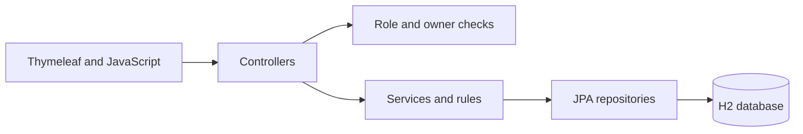

Registration locks the camp before counting places. Donation recording locks the donor and camp, then updates the donation, donor, registration and stock in one transaction. Fulfillment locks the request and matching stock, checks the full amount before deducting, and changes Pending to Fulfilled. A second fulfillment is rejected. Version fields on requests and stock detect competing edits.

Passwords use BCrypt. JWTs contain account ID and role, expire after two hours and stay in session storage. The default signing key changes on restart; JWT_SECRET can supply a persistent key. The H2 console is disabled and the app listens on localhost by default.

## Patterns and principles

| Pattern | Category | Working example |
| --- | --- | --- |
| Simple factory | Creational | BloodRequestFactory creates Routine, Urgent or Critical subclasses and sets their priority |
| Adapter | Structural | EmailServiceAdapter implements NotificationService using the logging API for local delivery simulation |
| Observer | Behavioral | CampPublishedEvent is handled by CampEventListener asynchronously after publication commits |
| Strategy | Behavioral | AllocationStrategy chooses stock by date added (FIFO) or nearest expiry (Priority) for fulfillment |

Spring supplies dependency injection, singleton component scope and MVC. The four application patterns are separate from those framework facilities. Camp notices are logged; no email or SMS is sent.

| Principle | Example |
| --- | --- |
| Single responsibility | EligibilityCriteria checks donor rules; CampService controls camp lifecycle |
| Open/closed | Another allocation order can implement AllocationStrategy without changing the fulfillment loop |
| Liskov substitution | Every request subclass works as BloodRequest and supplies its computed priority |
| Dependency inversion | The camp listener depends on NotificationService; stock selection uses AllocationStrategy |

## Use case model

An editable UML use case model is in [BloodDonationSystem_UseCaseDiagram.drawio](docs/BloodDonationSystem_UseCaseDiagram.drawio). The view below shows the role associations and included checks.

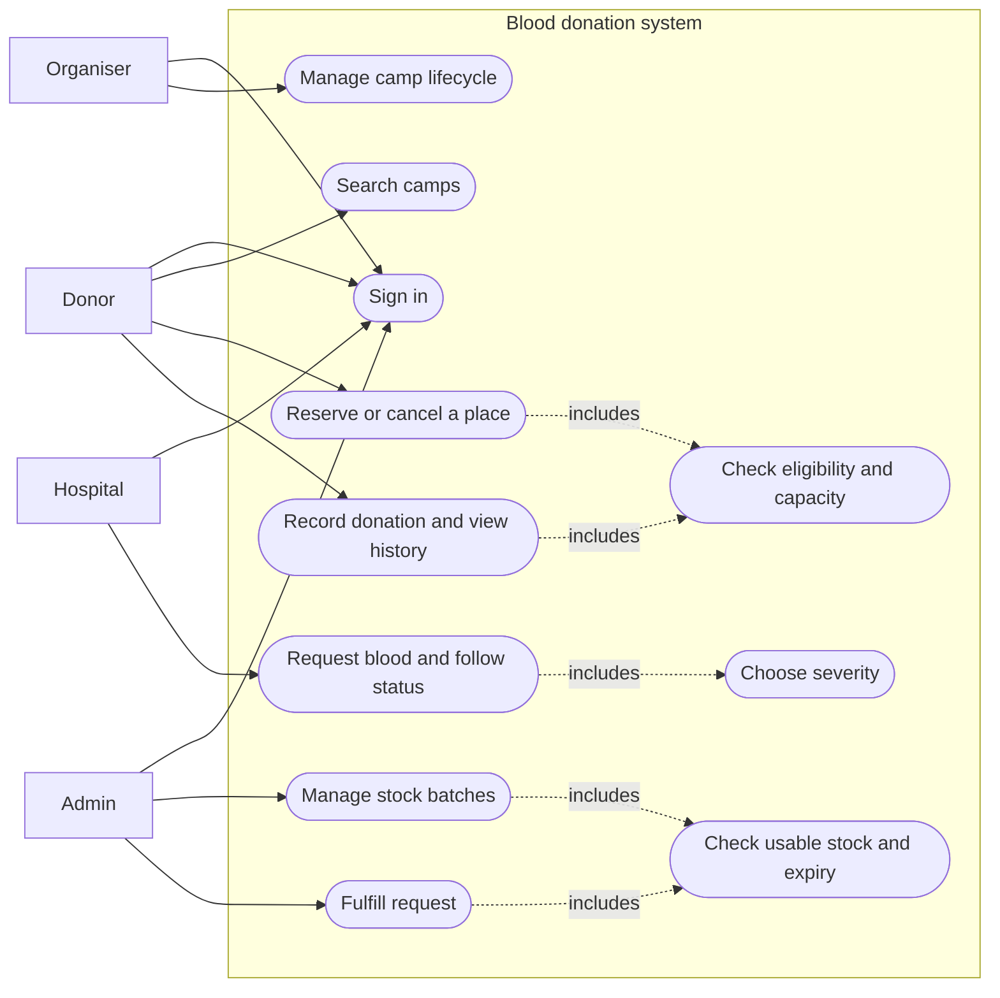

## Class model

IDs are UUIDs. Request subclasses share blood_request using a severity discriminator. Registration has a unique donor/camp pair. Associations record ownership and links between visits, requests and stock. No separate reports or allocation-history entities are used.

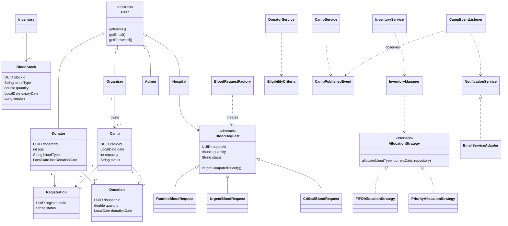

## Activity models

### Camp management

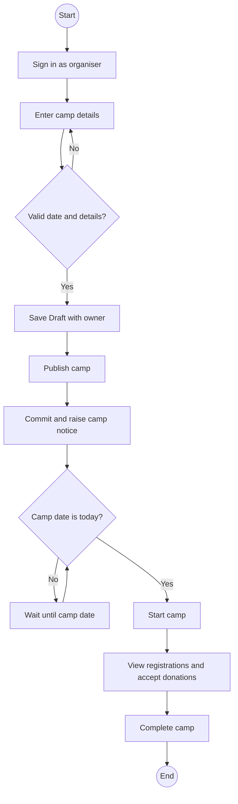

### Donor visit

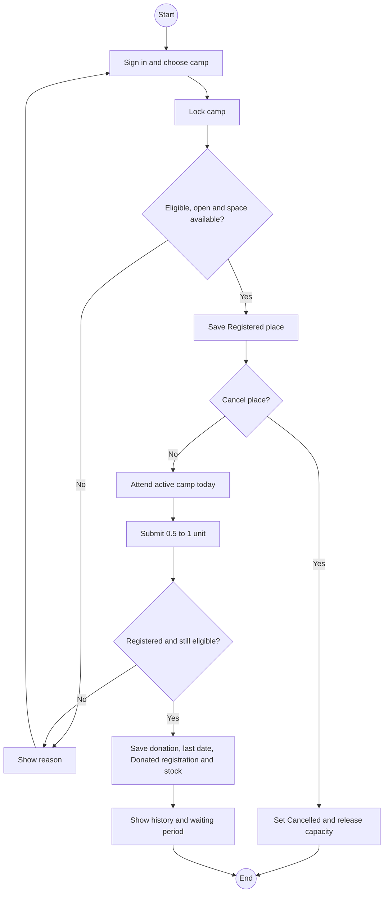

### Hospital request

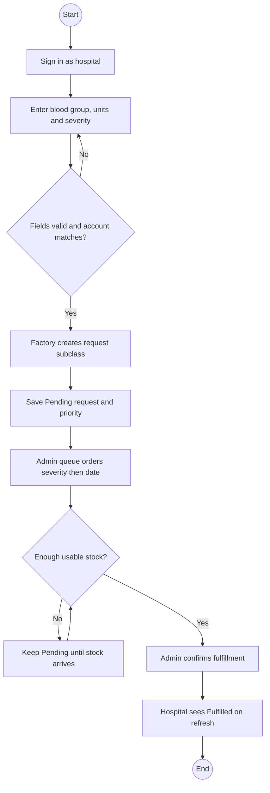

### Inventory management

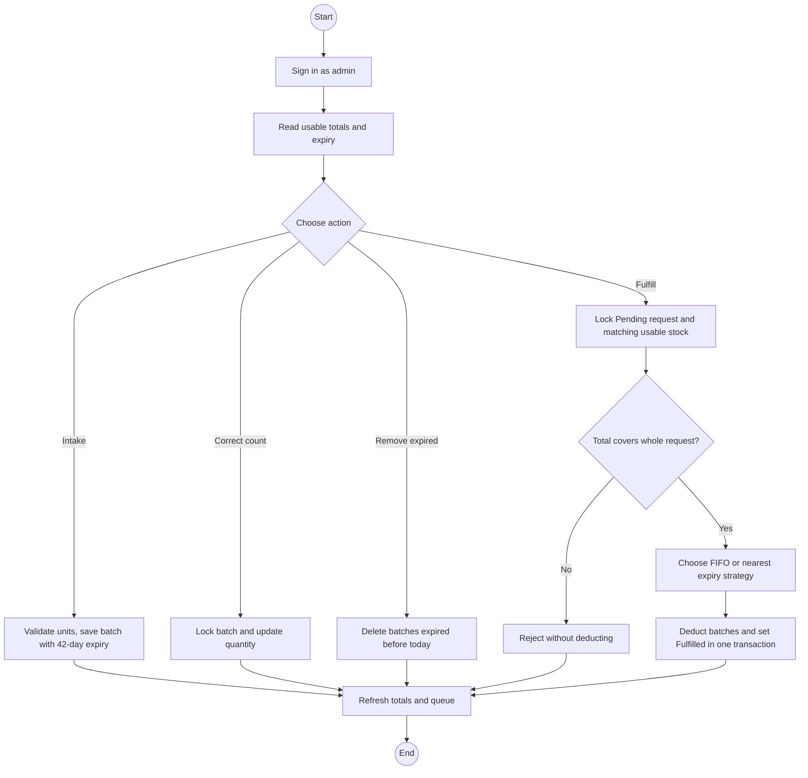

## State models

### Camp

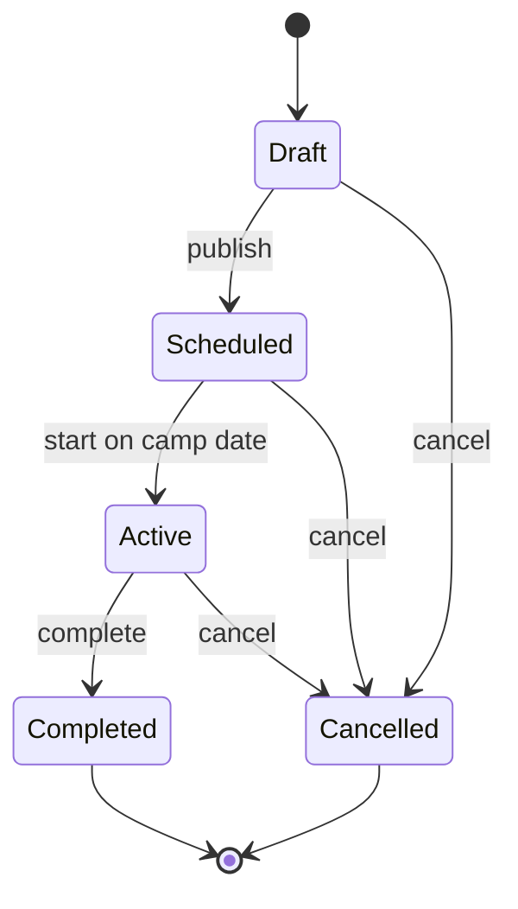

### Donor eligibility

Eligibility is computed from age and last donation date on each check, not a scheduled background update.

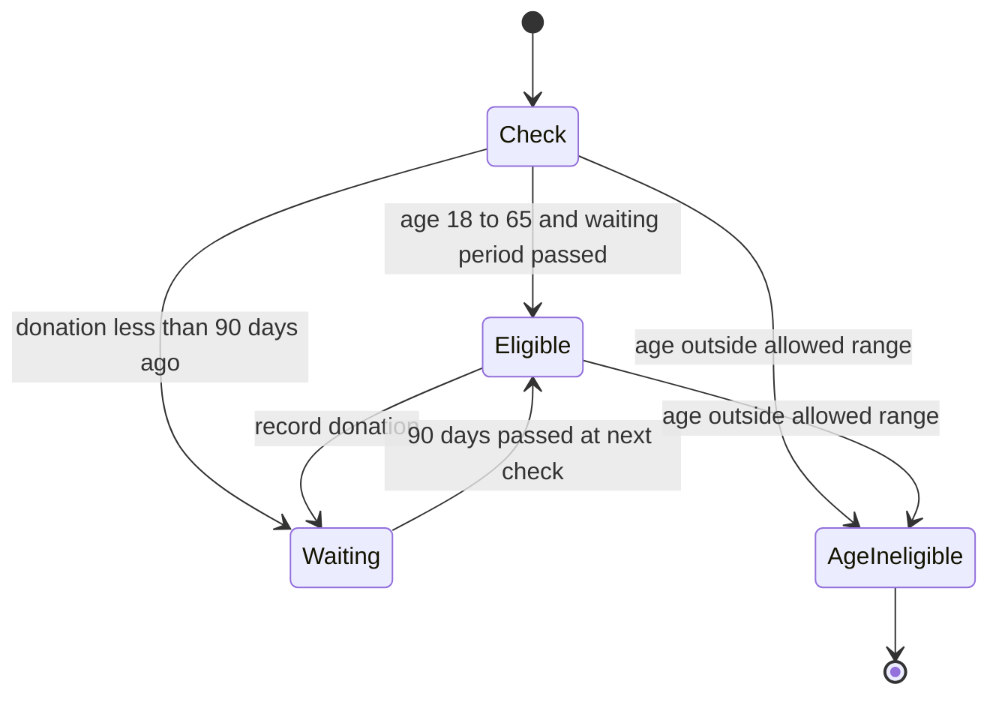

### Blood request

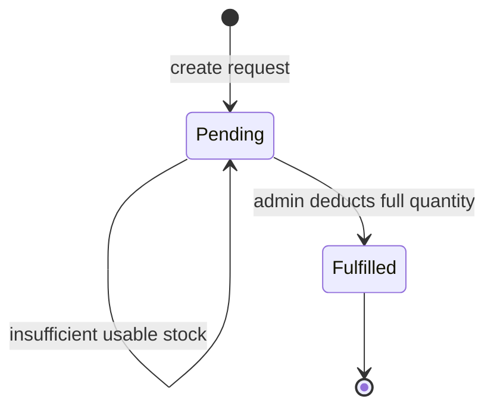

### Stock batch

These states describe date and quantity, not a stored status column.

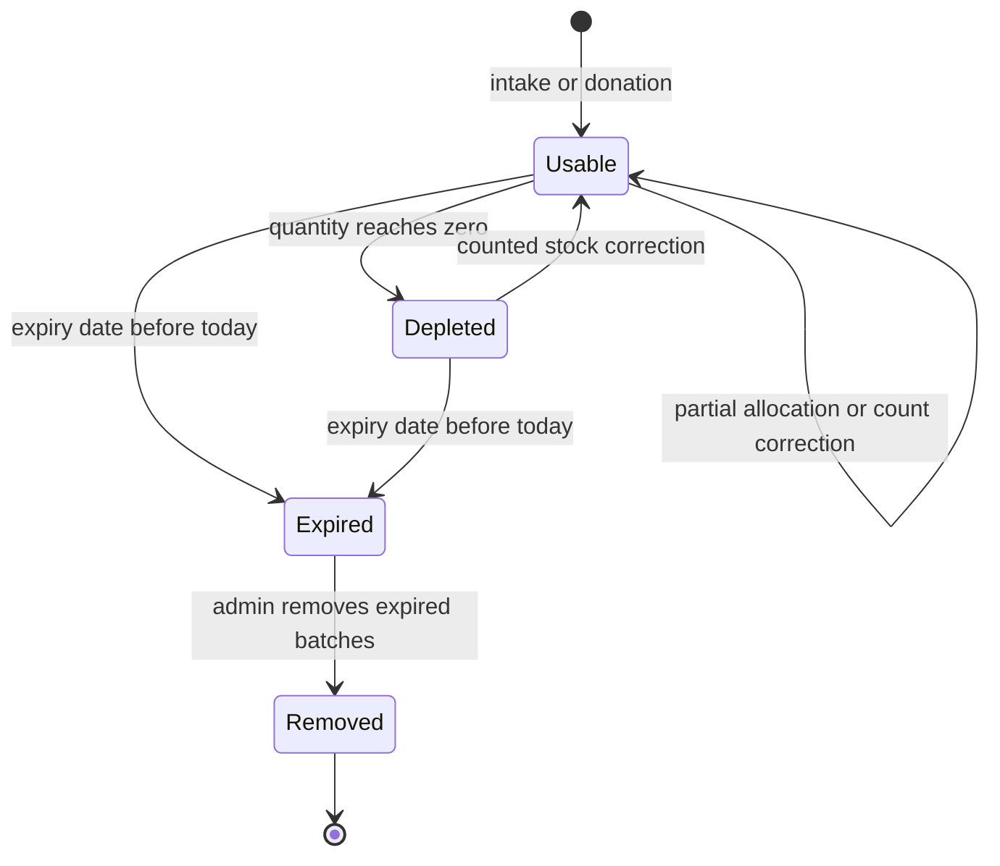

## Team context

Most implementation and the later repo polish were handled by Sathwik HS. The team split modules for the original presentation. The remaining member-to-module allocation was not recorded, so these notes do not assign individual implementation credit without that information. The module table is a useful way to split a walkthrough.

## Screenshots

These come from the running app with sample inputs and results. The current UI is dark; the original guidelines requested white backgrounds for submission screenshots. No new submission report is being prepared.

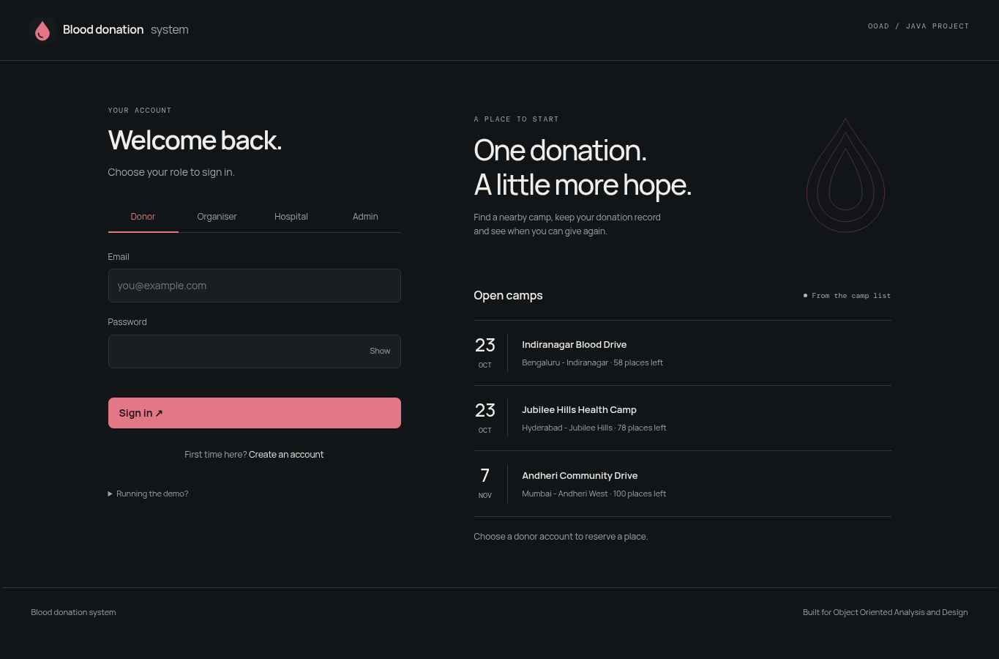

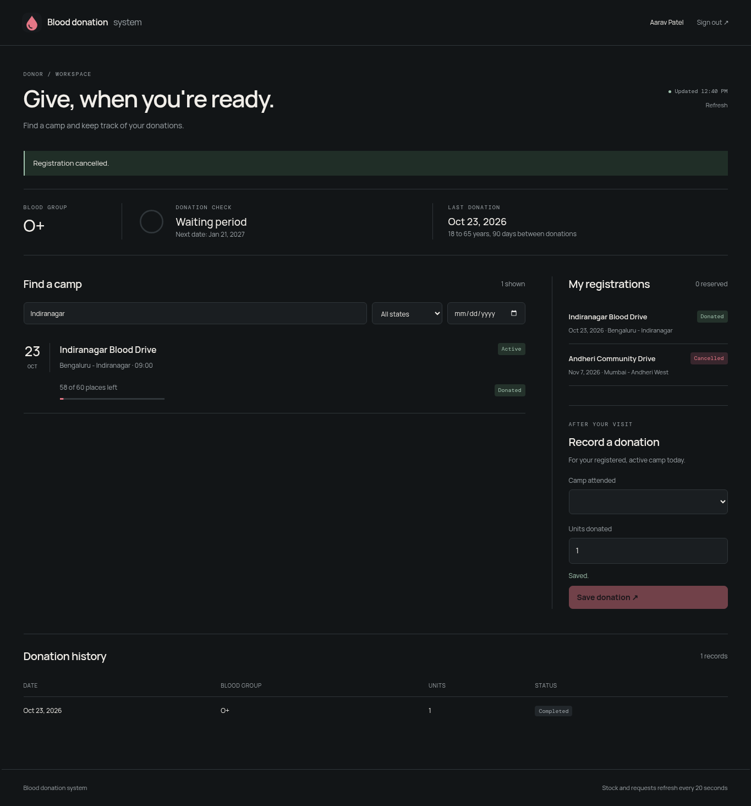

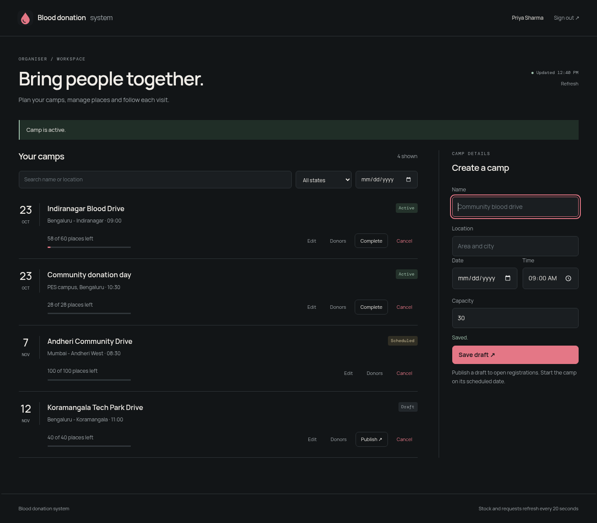

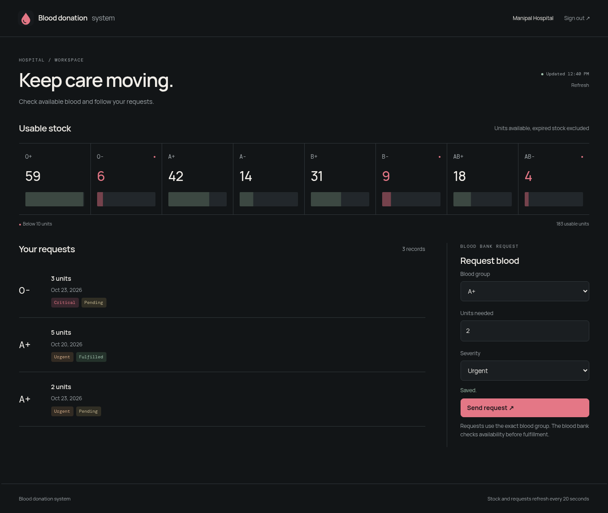

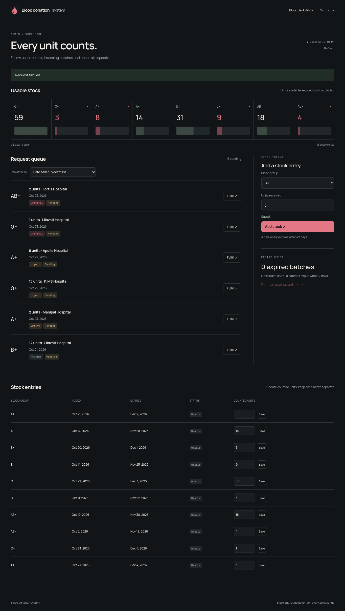

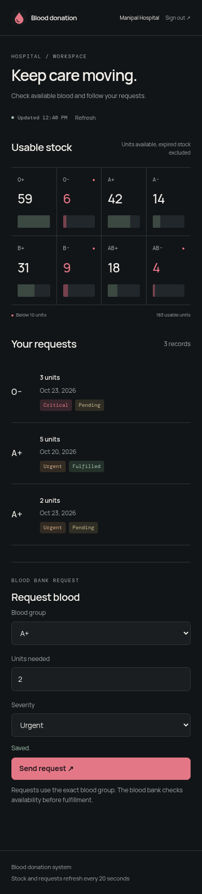

## Validation and limits

Run ./mvnw test for startup, age eligibility, role and ownership restrictions, malformed input and JWTs, donation updates, duplicate registration, cancellation, camp rules, concurrent capacity limits, stock expiry, allocation order and repeat fulfillment. Run ./mvnw package to produce the runnable jar.

Chrome checks cover the four role workflows, desktop and mobile layouts, form feedback, timed refresh, offline recovery and invalid sessions. Inputs are labelled and the UI has keyboard focus, native confirmation dialogs and reduced-motion styles.

No maps, certificates, compatibility matching, analytics, payments or real messaging are implemented. There is one inventory location. Public organiser and hospital signup are suitable for the local demo; there is no account approval process. H2 and simple queries keep the project easy to run and explain.
